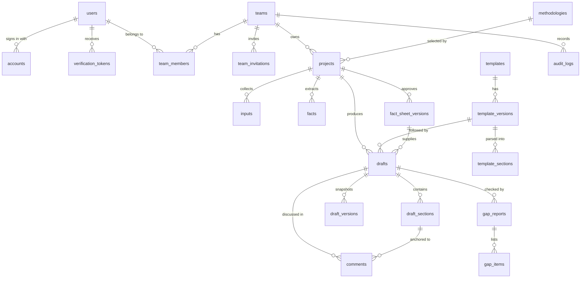

# Data model — step 1

**Status:** proposed, implemented in migration `migrations/0001_init.sql`, waiting for product-owner approval before step 2.

**Database:** MySQL 8.0 / MariaDB 10.4+ (InnoDB, `utf8mb4_unicode_ci`, all times UTC).
**Scope:** PRD requirements F1 (accounts, teams, roles), F4/F5 groundwork (projects, inputs, facts, drafts), F13 groundwork (templates, template versions), F9/F10 groundwork (version history, audit). Billing (F12) is deliberately **not** in this schema yet; it lands with step 10 so its shape follows the real checkout flow.

The PRD proposed PostgreSQL + pgvector. The product owner chose the XAMPP PHP + MySQL stack instead; the consequences are recorded in [decisions](decisions.md#adr-001-php-8-on-xampp-instead-of-node--postgresql) and [pgvector replacement](decisions.md#adr-002-mysql-instead-of-postgresql).

---

## 1. Conventions

| Convention | Decision | Why |
| --- | --- | --- |
| Primary keys | `CHAR(36)` UUID v4, generated in PHP (`App\Uuid`) | IDs are safe in URLs, never leak row counts, and survive exports/imports between environments. |
| Timestamps | `DATETIME(3)`, UTC, `CURRENT_TIMESTAMP(3)` defaults | Millisecond precision for ordering; UTC everywhere (the PDO connection pins `time_zone = '+00:00'`). |
| Soft delete | `deleted_at` on `users`, `teams`, `projects`, `inputs` | The privacy rule needs "deletable on request within 30 days" and audit history needs to survive. |
| Enumerations | MySQL `ENUM` | Values are a closed set owned by the product, not user data. |
| Structured data | `JSON` columns | Template format rules, settings, citations and snapshots evolve faster than tables. |
| Partial uniqueness | `PERSISTENT` generated columns + unique index | MySQL has no partial indexes; this reproduces "one owner per team" and "one live invitation per email". |
| Generated columns | **Numeric flags, never CHAR expressions** | MariaDB 10.5+ refuses expressions whose result depends on `sql_mode=PAD_CHAR_TO_FULL_LENGTH` in STORED generated columns (`ERROR 1901`), so a CHAR copy of `team_id` cannot be imported there. `owner_scope` is `TINYINT` (1 = owner, NULL otherwise) and the key is `(team_id, owner_scope)` — see [ADR-011](decisions.md#adr-011-portable-one-owner-per-team-key). |
| Tenant key | `team_id` on every tenant-owned row | Every tenant query filters on it; the access layer (`src/Tenancy.php`) is the only way to obtain it. |

---

## 2. Entity relationship overview

---

## 3. Tables

### 3.1 Identity and authentication

| Table | Purpose | Key columns and constraints |
| --- | --- | --- |
| `users` | One person. Local password and/or Google identity. | `email` + generated `email_lower` with **unique** index (case-insensitive uniqueness); `password_hash` nullable (Google-only accounts); `locale` (`en`/`fr`); `email_verified_at`; `otp_enabled` (optional sign-in second factor, default 0); `default_team_id` (no FK — teams reference users, a hard FK would be circular); `session_version` for revoking every session; `deletion_requested_at` + `deleted_at` for the privacy window. |
| `accounts` | Linked OAuth identity (Google at launch). | **unique (`provider`, `provider_account_id`)**; FK `user_id` cascade. |
| `verification_tokens` | Single-use emailed tokens: verify email, reset password, change email. | **unique** `token_hash` (SHA-256 only); `type`; `expires_at`; `used_at`; `requested_ip`. Never stores a plaintext token. |
| `email_outbox` | Every message the app wants to send. | `kind`, `body_text`, `sent_at`, `error`, `provider_message_id` (Resend id). The `log` transport writes here and to `storage/logs/mail.log`; with `resend` the body is mirrored to the log outside production. |
| `rate_limit_counters` | Fixed-window counters for sign-in, reset, resend and OTP attempts. | `counter_key` primary key, `window_start`, `count`. |
| `otp_codes` | Emailed one-time codes for sign-up verification and the sign-in second factor. | `purpose` (`signup`/`signin`); `code_hash` (**SHA-256 only**); `attempts`; `expires_at`; `consumed_at`; `requested_ip`; **key** (`user_id`,`purpose`,`consumed_at`). One active code per user and purpose — a resend consumes the previous row. |

No sessions table: PHP's native session store plus `users.session_version` gives signed-in state and instant revocation without another table (see ADR-003).

### 3.2 Tenancy

| Table | Purpose | Key columns and constraints |
| --- | --- | --- |
| `teams` | Workspace. Personal workspace created at sign-up; teams can grow. | **unique** `slug`; `owner_user_id` (FK, `RESTRICT`); `is_personal`; `plan` (`free`/`payg`/`team`); `data_region`; `settings` JSON; soft delete. |
| `team_members` | Membership + role. | **unique (`team_id`,`user_id`)**; `role` (`owner`/`admin`/`editor`/`viewer`); `status` (`active`/`suspended`); generated `owner_scope` + **unique index** = at most one owner per team. |
| `team_invitations` | Pending invitations. | **unique** `token_hash`; generated `live_email` + **unique (`team_id`,`live_email`)** = one live invitation per email per team; `expires_at`, `accepted_at`, `revoked_at`. |

### 3.3 Registries and template library (F2, F13 groundwork)

| Table | Purpose | Key columns and constraints |
| --- | --- | --- |
| `methodologies` | Launch methodology catalogue. | **unique (`registry`,`code`,`version`,`language`)**; `is_active`; `is_provisional` (launch shortlist still needs product-owner sign-off). |
| `templates` | Admin-curated asset: PDD template, methodology document, approved public PDD or guidance. | `kind`; `registry`; `methodology_code`; `language`. |
| `template_versions` | A specific version of an asset. | **unique (`template_id`,`version_label`)**; `status` (`draft`/`published`/`retired`); `effective_date`; `source_url` + `license_note` (**required by the licensing hard rule**); checksum; storage key. |
| `template_sections` | Parsed structure of a version. | **unique (`template_version_id`,`stable_key`)**; `parent_section_id` for nesting; `ordinal`; `heading`; `level`; `is_required`; `allow_intentionally_blank`; `guidance`; `format_rules` JSON (date format `DD/MM/YYYY`, number format, unique figure/table IDs). |

Template rules live here as **data**, not prompts. Publishing a new version is an admin action, and every project/draft records the version used.

### 3.4 Project pipeline (F2–F5 groundwork)

| Table | Purpose | Key columns and constraints |
| --- | --- | --- |
| `projects` | One PDD project. | `team_id` (tenant key); `name`; `country_code` (`CHAR(2)`); `registry`; `project_type`; `methodology_id`; `template_version_id` (**version used**); `status`; `language`; `confidentiality` (`public`/`confidential`); crediting period dates; soft delete. Registry/methodology/type are nullable until the step-3 wizard completes, then required on transition. |
| `inputs` | Raw material: pasted text, documents, transcripts, screenshots, short recordings. | `team_id` + `project_id`; `kind`; `status` (`pending`→`parsed`); `storage_key`; checksum; `source_text` for pasted input; language. |
| `facts` | Typed facts extracted from inputs and **confirmed by the user**. | **unique (`project_id`,`fact_key`)**; `category`; `value_type` + typed value columns (`value_numeric` `DECIMAL(18,4)`, `value_date`, `value_text`, `value_json`); `confidence`; `status` (`ai_suggested`/`confirmed`/`corrected`/`rejected`/`needs_input`); provenance (`source_input_id`, `source_quote`, `source_locator`); `confirmed_by_user_id`/`confirmed_at`. |
| `fact_sheet_versions` | Immutable snapshot of the approved fact sheet. | **unique (`project_id`,`version`)**; `status` (`draft`/`approved`/`superseded`); `snapshot` JSON; approver + timestamp. Drafting is only possible against an approved version, which implements "the user approves the fact sheet before any drafting". |

### 3.5 Drafts, checks and collaboration (F5–F9 groundwork)

| Table | Purpose | Key columns and constraints |
| --- | --- | --- |
| `drafts` | One generated PDD draft. | `team_id` + `project_id`; **non-null** `template_version_id` and `fact_sheet_version_id` (both `RESTRICT` so history cannot point at deleted versions); `language`; `status`; `is_labeled_draft` (always "draft" for AI output). |
| `draft_sections` | One PDD section. | **unique (`draft_id`,`template_section_id`)**; `heading`; rich text `content_json` + plain `content_text`; `status` (`needs_input`/`generated`/`edited`/`approved`/`intentionally_blank`); `citations` JSON list of `{factId?, sourceInputId?, quote?, locator?}`. |
| `draft_versions` | Snapshot for history and restore (F9). | **unique (`draft_id`,`version`)**; `snapshot` JSON; author. |
| `comments` | Inline comments anchored to a section (F7). | `draft_section_id`; author; `anchor` JSON; resolve fields. |
| `gap_reports` / `gap_items` | Gap and consistency checker output (F6). | `severity`; `type` (`missing_fact`, `inconsistent_number`, `inconsistent_date`, `inconsistent_location`, `weak_evidence`, `format_rule`, `missing_citation`, `unsupported_number`); `section_key`; `fact_key`. |
| `audit_logs` | Append-only security and product trail (F10). | `team_id`; `actor_user_id`; `action` (e.g. `auth.signin`, `team.invitation.accepted`, `project.created`); `target_type`/`target_id`; `metadata` JSON; IP + user agent. |

### 3.6 Organization onboarding (product-owner request, migration 0003)

| Table | Purpose | Key columns and constraints |
| --- | --- | --- |
| `organization_profiles` | Verified identity of the organization behind a workspace. | **unique** `team_id` (cascade); legal name, trading name, registration number/country, organization type, year founded, website, registered address, city; primary contact (name, role, email, phone); `status` (`draft`/`submitted`/`verified`/`rejected`); `submitted_at`, `reviewed_at`, `review_note`; attestation (`attested_at`, `attested_by_user_id`). |
| `organization_documents` | The current verification document per requirement. | **unique (`team_id`,`kind`)**; `original_filename`, `storage_key`, `mime_type`, `size_bytes`, `checksum_sha256`; `kind` (`registration_certificate`/`ownership_structure`/`declaration`/`tax_compliance`); uploader. |

Wizard progress is **derived** from these rows ([organization onboarding](organization-onboarding.md)), so there is no wizard-progress table to keep in sync. Which document kinds are required lives in `OnboardingService::DOCUMENTS`, not in a schema constraint, so a document can be added without a migration.

---

## 4. Invariants the schema enforces

1. **Case-insensitive email uniqueness** — one person, one email, regardless of typing case.
2. **Exactly one owner per team** — `owner_scope` is a generated `TINYINT` flag (1 for the owner, NULL for everyone else) with a unique `(team_id, owner_scope)` index. NULLs repeat in a unique index, so only owners are constrained; a second owner row is impossible even under concurrency, and the definition remains importable on MariaDB 10.5+ (ADR-011).
3. **One live invitation per email per team** — dead invitations (accepted/revoked) leave the unique index's scope, so re-inviting later works.
4. **No draft without an approved fact sheet and a recorded template version** — both FKs are `NOT NULL`.
5. **No orphan tenant data** — every tenant-owned row cascades from `teams`; audit rows survive with `SET NULL`.
6. **Numbers are typed, not strings** — `value_numeric`/`value_date` mean generators can copy values verbatim; free-form values go to `value_text`/`value_json`.
7. **No submission without the required documents** — enforced in `OnboardingService::submit()` (a cross-row rule MySQL cannot express as a constraint): all required document kinds must exist and steps 1–2 must be complete before `status` leaves `draft`.
8. **One active sign-in code per purpose** — enforced by `OtpService` (`UPDATE … consumed_at` on issue); only the hash is stored, so a database dump cannot be replayed as a valid code.

### Role matrix

| Action | viewer | editor | admin | owner |
| --- | :---: | :---: | :---: | :---: |
| Read projects, facts, drafts | ✓ | ✓ | ✓ | ✓ |
| Create/edit projects and content | | ✓ | ✓ | ✓ |
| Delete projects | | | ✓ | ✓ |
| Invite editors/viewers, revoke invitations | | | ✓ | ✓ |
| Invite admins | | | | ✓ |
| Change roles, remove members | | | | ✓ |
| Read the organization profile and its documents | ✓ | ✓ | ✓ | ✓ |
| Edit the organization profile, upload documents, submit for verification | | | ✓ | ✓ |
| Delete/transfer the workspace | | | | ✓ |

---

## 5. Tenant isolation

- `team_id` is present on every tenant-owned table (projects, inputs, facts, drafts) and duplicated on rows that are reached through a project (`inputs`, `facts`, `drafts`) so a single filter suffices.
- `src/Tenancy.php` is the **only** way to turn a signed-in user into a team or project scope. It requires an active membership and a minimum role.
- Repositories (`src/Repositories/*`) only accept a team id from that scope and always filter on it.
- Cross-tenant lookups fail as **404**, not 403, so IDs cannot be enumerated across workspaces.
- Tests: `tests/tenant_isolation_test.php` (8 cases, including repository-level filtering and audit scoping), plus an HTTP-level cross-tenant check in `tools/e2e-smoke.ps1`.

---

## 6. Hard-rule traceability

| PRD hard rule | Where the model enforces it |
| --- | --- |
| Every claim cites its input/fact | `draft_sections.citations` (required list; checker emits `missing_citation` items). |
| Numbers only from the confirmed fact sheet | Typed `facts` columns + `draft_sections` read-only generator contract; content is copied from the fact sheet, never generated. |
| Fact sheet approved before drafting | `drafts.fact_sheet_version_id` is non-null and points at an `approved` snapshot. |
| AI output labelled a draft | `drafts.is_labeled_draft` + section-level `needs_input`; French output is `language = 'fr'` and will carry the "working draft" label (step 6). |
| Private data, deletable within 30 days | Soft delete + `deletion_requested_at`; tenant isolation; no shared-library write path for customer data. |
| Only admin-curated material in the library | `templates`/`template_versions` are separate from project inputs; `source_url` and `license_note` are stored per version. |
| Rules are versioned data | `template_versions` + `template_sections.format_rules`; projects and drafts record the version id. |
| Gold Standard formatting | `format_rules` carries DD/MM/YYYY, thousands-comma/decimal-point and unique figure/table IDs; `draft_sections.status = intentionally_blank` covers non-applicable sections. |
| Public and confidential versions | `projects.confidentiality`. |

---

## 7. Implementation status in step 1

| Area | State |
| --- | --- |
| Schema + migration | Complete: `migrations/0001_init.sql`, applied by `bin/setup.php` to `pdd_generator` and `pdd_generator_test`. |
| Auth (F1) | Complete: email/password with an emailed one-time code as the sign-in second factor, Google OAuth, password reset, rate limiting, audit. |
| Teams and roles (F1, F10 partial) | Complete: personal workspace, invitations, role rules, member management, audit. |
| Projects (F2 groundwork) | Create/list/detail/soft delete with tenant isolation. The wizard is step 3. |
| Organization onboarding (product-owner request) | Complete: 4-step wizard, document uploads, declaration template, submit/lock and audit. Admin review console is a later step. |
| Inputs, facts, templates, drafts tables | Created and indexed; APIs/UI arrive in steps 2–8. |
| Billing (F12) | Not in this migration; step 10. |

---

## 8. Decisions that would benefit from your review

1. **Project types** are provisional (`cookstoves`, `afforestation_reforestation`, `renewable_energy`, `clean_water_access`, `improved_agriculture`, `other`). The final list should follow the Africa-first methodology answer.
2. **One fact per key** (`unique (project_id, fact_key)`) — a fact has one current value; history lives in `fact_sheet_versions` snapshots. Alternative: keep fact revisions in their own table if you want per-fact history.
3. **Template sections only** in this migration. Template *fields* (individual required inputs inside a section, with types and validation rules) are likely needed in step 2; propose adding `template_fields` when the parser is built rather than guessing now.
4. **Methodology catalogue** is seeded with a provisional shortlist; needs your sign-off (see [open questions](open-questions.md)).
